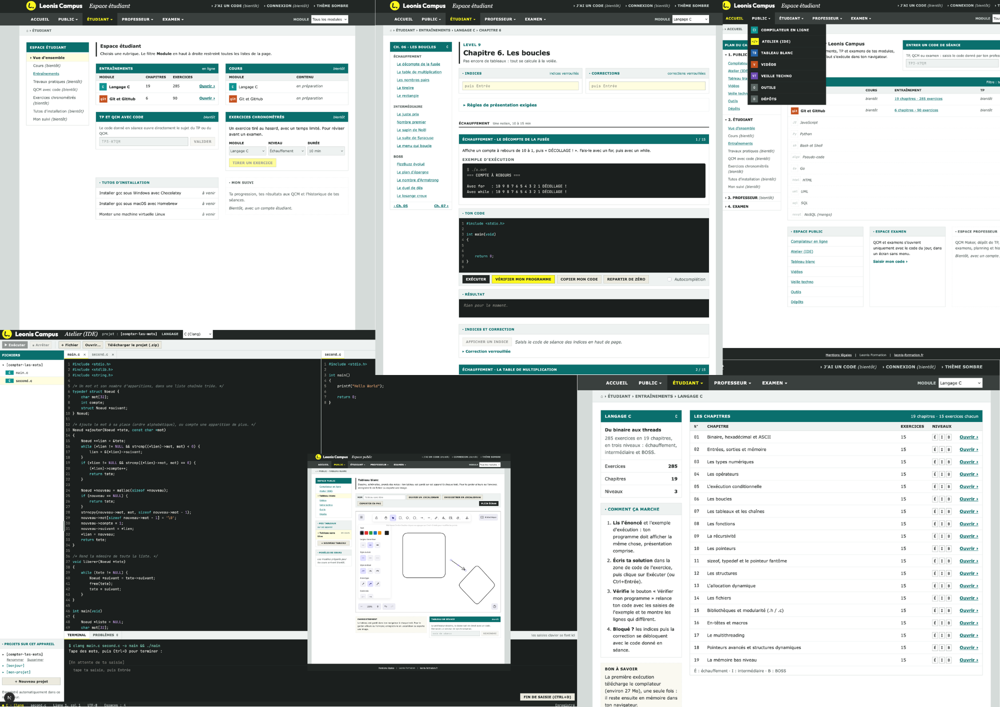

# 🦁 Leonis Campus - WORK IN PROGRESS 🚧⚠️

> Pour découvrir cette future plateforme, c'est par ici ! C'est un petit projet perso où j'essaie d'assembler un tas de petits travaux que j'ai bidouillés depuis des années. 🛠️

*Note : Le vrai code source est gardé bien au chaud dans un dépôt privé. Cette page est juste une petite vitrine pour montrer à quoi ressemble le projet de l'extérieur !*

## 🚀 Accès

🌐 **Jeter un œil au projet :** [https://miloanton.github.io/leonis-campus/](https://miloanton.github.io/leonis-campus/)

---

## 📸 Aperçu

---

## ✨ Ce qu'il y a dedans (ou ce qui arrive bientôt)

L'idée, c'est d'avoir plusieurs espaces selon ce qu'on vient y faire :

### 🌍 L'espace Public (Ouvert à tous)
- Un petit compilateur en ligne pour tester du code direct.
- Un petit IDE pour des tests plus gros
- Un tableau blanc (Excalidraw) intégré pour gribouiller des schémas ou bientôt rejoindre les tableaux de profs.
- Des listes pratiques que j'ai compilées : vidéos, veille tech, outils sympas et repos GitHub à fouiller. Qui seront participatives. 

### 🎓 L'espace Étudiant
- Le coin pour apprendre : cours, entraînements...
- Des TP et QCM (accessibles avec un code).
- Des exos aléatoires chronométrés pour se tester sous pression.
- Des tutos de survie (gcc, brew, chocolatey, comment monter une VM...).

### 👨‍🏫 L'espace Prof
- De quoi créer des QCM (QCM Maker) et des TP facilement.
- Lancement d'examens et suivi.
- Un petit planning et l'historique complet de ce qui a été fait.

### 🕵️‍♂️ L'espace Examen & Anti-triche "Maison"
Parce qu'il faut bien surveiller un peu pendant les exams, j'ai bricolé quelques vérifs :
- Détection des sorties de fenêtre, des Alt-Tab et des redimensionnements.
- Suivi des mouvements de la souris (si elle s'égare trop loin).
- Repérage des textes copiés-collés.
- Petits marqueurs "IA" (coucou les em-dash de ChatGPT...) et comptage suspect de commentaires.
- Et même une vérif de plagiat entre les codes des étudiants.

---

## 🛠️ Le labo (Stack technique)

- **Frontend :** Next.js ⚛️
- **Backend :** À venir ! J'hésite encore sur la techno vu que mes anciens petits travaux perso sont codés dans un peu tout et n'importe quoi. Le choix n'est pas encore fait. 🤷‍♂️
- **Hébergement :** GitHub Pages pour l'instant (ça fait très bien l'affaire pour démarrer), à voir par la suite selon les besoins du backend !

---

👋 **Bidouillé par [Moi](https://github.com/miloanton)**
